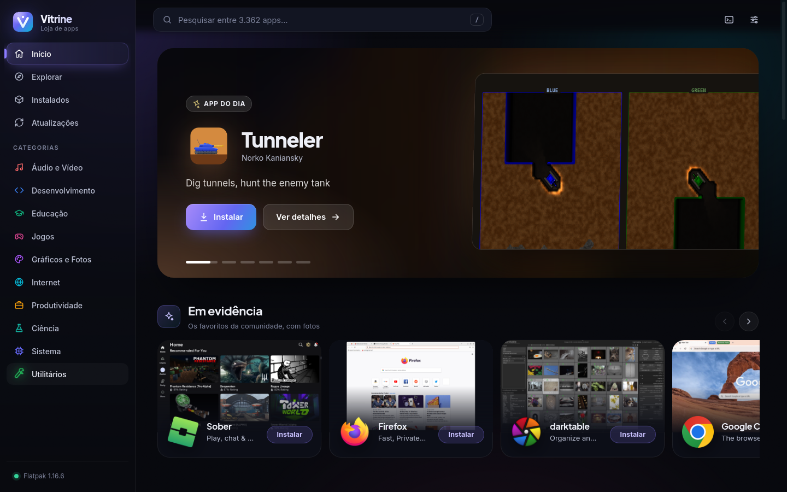
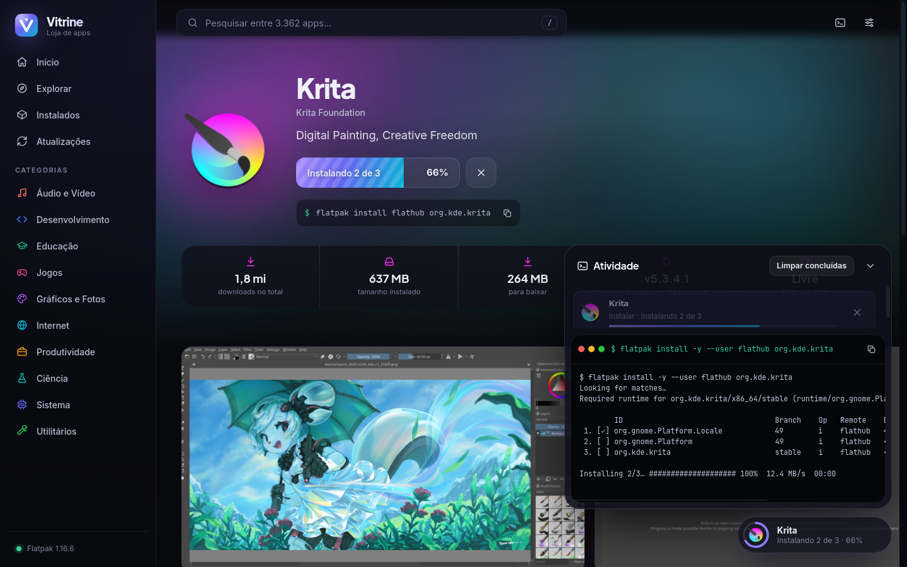

<p align="center">
  
</p>

<h1 align="center">Vitrine</h1>

<p align="center"><b>Uma loja de aplicativos bonita para o Ubuntu.</b><br>
Todos os apps do Flathub, com fotos, e instalação em um clique.</p>



## O que ela faz

- **Todos os apps do Flathub** (mais de 3.300), com ícones, capturas de tela, descrição, versões e tamanho
- **Instalar com um clique**: o botão roda `flatpak install` de verdade e mostra o progresso ao vivo
- **Fila de instalações**: clique em vários apps e eles são instalados um de cada vez
- **Painel de atividade** com o comando exato e a saída do terminal
- **Abrir, remover e atualizar** os apps instalados
- **Configura o Flatpak sozinha** se ele ainda não estiver no sistema (pede a senha uma vez)
- **Animações**: transições entre telas, ícones que "voam" até a página do app, carrossel em destaque, brilhos na cor de cada app

Feita em JavaScript nativo do GNOME (GJS + WebKitGTK). Sem Python e sem Electron.

| Explorar | Página do app | Instalando |
|---|---|---|
|  |  |  |

## Instalar

```bash
git clone https://github.com/Rodolfinnrss/vitrine.git
cd vitrine
./install.sh
```

Depois procure **Vitrine** no menu de aplicativos, ou rode `vitrine` no terminal.

Para remover: `./install.sh --remove`. Para rodar sem instalar: `./vitrine`.

### Requisitos

Ubuntu com GNOME (testado no 26.04). Se faltar alguma biblioteca, o `install.sh` avisa. Para instalar tudo de uma vez:

```bash
sudo apt install gjs gir1.2-webkit2-4.1 gir1.2-soup-3.0
```

O Flatpak não precisa estar instalado: a Vitrine oferece configurá-lo no primeiro uso.

## Comandos que a loja executa

| Ação | Comando |
|---|---|
| Instalar (padrão, "só para mim", sem senha) | `flatpak install -y --user flathub <id>` |
| Instalar ("para todos", pede senha) | `flatpak install -y --system flathub <id>` |
| Abrir | `flatpak run <id>` |
| Remover | `flatpak uninstall -y --user\|--system <id>` |
| Atualizar | `flatpak update -y --user\|--system [<id>]` |
| Configurar o Flatpak | `pkexec apt-get install -y flatpak` + `flatpak remote-add flathub` |

## Atalhos

- `/` ou `Ctrl+K`: pesquisar
- `Alt+←`, `Backspace` ou o botão "voltar" do mouse: voltar
- `Esc`: fechar janelas e limpar a busca

## Problemas

- **A tela pisca ou fica vazia**: em Preferências, desligue **Aceleração por GPU** e abra a Vitrine de novo.
- **O app instalado não aparece no menu do Ubuntu**: saia e entre de novo na sessão uma vez.
- **Ver o que está acontecendo**: rode `VITRINE_DEBUG=1 vitrine` no terminal (habilita também o inspetor web com o botão direito).

## Como é feita

- `main.js`: janela GTK, ponte com a interface e execução dos comandos `flatpak` num pseudo-terminal, para ler a porcentagem
- `ui/`: interface em HTML, CSS e JavaScript, com dados da [API pública do Flathub](https://flathub.org/api/v2/docs)
- As preferências ficam em `~/.config/vitrine/config.json`

Dados, ícones e capturas de tela dos apps pertencem aos seus autores e vêm do [Flathub](https://flathub.org). A Vitrine não é afiliada ao Flathub.

## Licença

[MIT](LICENSE)
